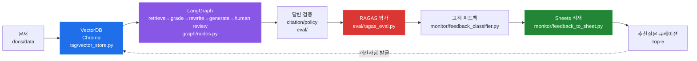

# rag-ops-console

Online RAG 운영 콘솔 — VectorDB 검색 · LangGraph 오케스트레이션 · RAGAS 평가 · 답변 검증 · 고객 피드백 모니터링→Sheets · 추천질문 큐레이션을 한 곳에서 운영하는 실전 RAG Ops.

> **카카오뱅크 AI 운영 어시스턴트 JD 정렬**
>
> - RAG 문서 생성 및 관리
> - 고객 피드백 모니터링 및 개선사항 발굴
> - 모델 업데이트 시 답변 검증 및 개선사항 발굴
> - 선제안/추천 질문 콘텐츠 운영
> - AI 데이터 모니터링
>
> 본 콘솔은 위 운영 업무를 **VectorDB 검색 → LangGraph 오케스트레이션 → RAGAS 평가 → 답변 검증 → 고객 피드백 모니터링→Sheets → 추천질문 큐레이션** 파이프라인으로 구현한다.

## JD 문장 그대로 목차

| # | JD 키워드 | 모듈 | 설명 |
|---|-----------|------|------|
| 1 | **VectorDB 검색** | `rag/vector_store.py` | Chroma persistent 임베딩 · 검색 · rerank (실명 VectorDB) |
| 2 | **LangGraph 오케스트레이션** | `graph/` | retrieve → grade → rewrite → generate → human review 4~5노드 조건부 라우팅 |
| 3 | **RAGAS 평가** | `eval/ragas_eval.py` | context precision / recall · faithfulness · answer relevancy |
| 4 | **답변 검증** | `eval/`, `graph/nodes.py` | citation / policy / hallucination 검증 + human review 큐 |
| 5 | **고객 피드백 모니터링→Sheets** | `monitor/feedback_classifier.py` + `monitor/feedback_to_sheet.py` | 피드백 분류(긍정/부정/버그/개선) + Google Sheets 적재 |
| 6 | **추천질문 큐레이션** | `monitor/feedback_to_sheet.py` | Sheets 기반 상위 5개 추천 질문 큐레이션 |

## Offline / Online 경계

> **이 레포(B)는 online RAG 운영 콘솔 — 실명 VectorDB(Chroma), LangGraph, RAGAS는 여기서 담당한다.**
>
> - **Offline 품질/학습 평가** — synthetic data 생성, Rule 검증, LLM Judge, 오답 taxonomy, lm-eval / PyTorch 실험은 [`llm-eval-pipeline`](https://github.com/ianlyoo/llm-eval-pipeline) (A)에서 담당한다.
> - **Online 운영(B)** — VectorDB 검색, LangGraph 오케스트레이션, RAGAS 평가, 답변 검증, 고객 피드백 모니터링→Sheets, 추천질문 큐레이션이 본 레포의 책임이다.
> - **데이터 계약:** B는 A 산출물을 **consume**한다 — 예: `llm-eval-pipeline/data/synthetic_qa.jsonl`을 검색·평가 입력으로 링크/복사해 활용하되, **A의 `eval/` 코드를 복사하지 않는다** (Task 18에서 `diff`로 검증).
> - B는 A 없이도 동작하나, A의 합성 QA가 있으면 더 풍부한 RAGAS/회귀 평가가 가능하다.

```
llm-eval-pipeline (A, offline)          rag-ops-console (B, online)  ← this repo
┌─────────────────────────┐             ┌──────────────────────────────┐
│ synthetic_qa.jsonl ─────┼── consume ─►│ VectorDB(Chroma) 검색        │
│ rule/judge/lm-eval      │  (data)     │ LangGraph 5노드              │
│ pytorch_experiment      │  contract   │ RAGAS + 답변 검증            │
└─────────────────────────┘             │ 피드백→Sheets→추천질문       │
                                        └──────────────────────────────┘
```

## 아키텍처



## 구조

```
rag-ops-console/
├── rag/                        # VectorDB 검색 (Chroma)
│   ├── __init__.py
│   └── vector_store.py         # (예정) Chroma persistent + 임베딩/검색/rerank — Task 15
├── graph/                      # LangGraph 오케스트레이션 — Task 15
│   ├── __init__.py
│   ├── state.py                # LangGraph state 정의
│   └── nodes.py                # retrieve→grade→rewrite→generate→human review
├── eval/                       # RAGAS + 답변 검증 — Task 15
│   ├── __init__.py
│   └── ragas_eval.py           # (예정) RAGAS faithfulness/precision/recall
├── monitor/                    # 고객 피드백 운영 — Task 16
│   ├── __init__.py
│   ├── feedback_classifier.py  # 긍정/부정/버그/개선 + root-cause
│   └── feedback_to_sheet.py    # Google Sheets 적재 + 추천질문 Top-5
├── docs/
│   ├── architecture.mmd        # (예정) 운영 아키텍처 Mermaid
│   └── report.html             # (예정) RAGAS/피드백 리포트
├── data/                       # 샘플 문서/피드백 (대용량 원본은 .gitignore)
│   └── .gitkeep
├── tests/
│   └── test_scaffold.py
├── .github/workflows/ci.yml
├── requirements.txt
└── LICENSE
```

## 운영 흐름 — 카카오뱅크 스타일

1. **RAG 문서 생성·관리** — 문서를 청킹해 Chroma에 적재, 버전별 persistent 디렉터리로 관리.
2. **AI 데이터 모니터링** — LangGraph 트레이스(노드별 latency/grade 결과)와 RAGAS 지표를 `eval/ragas_eval.py`에서 집계.
3. **답변 검증** — citation 유무, policy 위반, hallucination 여부를 결정론적 룰 + RAGAS faithfulness로 이중 검증, 불확실 케이스는 human review 큐로 라우팅.
4. **고객 피드백 모니터링** — `monitor/feedback_classifier.py`가 `query/response/user_feedback`을 긍정/부정/버그/개선 + root-cause 태그로 분류.
5. **Sheets → 추천질문** — `monitor/feedback_to_sheet.py`가 분류 결과를 Google Sheets(`gspread`)에 적재하고, 빈도/실패 유형 기반 상위 5개 추천 질문을 큐레이션해 운영자가 선제안 콘텐츠로 활용.

## 설치

```bash
python -m venv .venv
# Windows: .venv\Scripts\activate
# macOS/Linux: source .venv/bin/activate
pip install -r requirements.txt
pytest -q
ruff check .
```

> **Heavy deps:** `chromadb`, `langgraph`, `ragas`는 본 레포의 핵심이므로 `requirements.txt`에 포함된다. 로컬 경량 실행 시 `pip install chromadb langgraph` 없이도 `pytest -q` / `ruff check .`는 통과하나, VectorDB/LangGraph 실행(Task 15)은 설치가 필요하다.

## CI

`.github/workflows/ci.yml` — `ubuntu-latest`, Python 3.11, `pip install -r requirements.txt` → `pytest -q` → `ruff check .`

## Offline / Online 상세

| 구분 | 담당 | 기술 | 산출물 |
|------|------|------|--------|
| **Offline (A)** | 품질·학습 평가 | synthetic data, rule filter, LLM Judge, taxonomy, lm-eval, PyTorch | `llm-eval-pipeline/data/synthetic_qa.jsonl` 등 |
| **Online (B, this repo)** | RAG 운영 | **VectorDB(Chroma)**, **LangGraph**, **RAGAS**, gspread | 검색/생성/검증/모니터링/Sheets |

B는 A의 코드를 복사하지 않고 A 산출물을 데이터로 consume한다. 경계 위반은 `diff -r llm-eval-pipeline/eval rag-ops-console/eval`로 검증한다.

## License

MIT — see [LICENSE](LICENSE)
