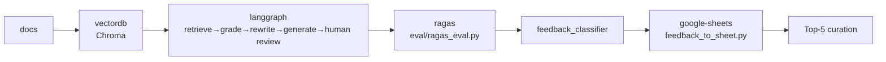

# rag-ops-console

[한국어](README.ko.md)

[](https://github.com/ianlyoo/rag-ops-console/actions/workflows/ci.yml)
[](LICENSE)
[](https://github.com/ianlyoo/rag-ops-console/releases/tag/v0.1.0)
[](https://ianlyoo.github.io/rag-ops-console/)

Online RAG Ops console with Chroma VectorDB and LangGraph 5 nodes — monitor retrieval quality with RAGAS and Sheets feedback loop in production.

> Companion repos: online console here, offline eval at [llm-eval-pipeline](https://github.com/ianlyoo/llm-eval-pipeline) (synthetic-data/harness), packet generation at [signal-foundry](https://github.com/ianlyoo/signal-foundry).

## Quick start — rag and vectordb with Chroma and LangGraph

Install from tarball (version-pinned):

```bash
gh release download v0.1.0 --pattern "*.tgz" --repo ianlyoo/rag-ops-console
npm install ./rag-ops-console-*.tgz
```

From source with bun (frozen lockfile):

```bash
git clone https://github.com/ianlyoo/rag-ops-console.git
cd rag-ops-console
bun install --frozen-lockfile
bun run build
```

Python environment (primary runtime):

```bash
python -m venv .venv
# Windows alternative: .venv\Scripts\activate
pip install -r requirements.txt
pytest -q
ruff check .
```

Run VectorDB ingest and console:

```bash
python -c "from rag.vector_store import ingest; print(ingest(reset=False))"
python -m graph.run --query "환불 정책" --log out/ops_rag.log
python -m eval.ragas_eval --output out/ragas_result.json
```

## Use cases for ragas and llm-judge with observability and feedback-loop

- **RAG retrieval quality** — Chroma vectordb search and rerank exposed via `rag/vector_store.py`; deterministic token-overlap scoring provides CI baseline without credentials.
- **LLM Judge and ragas** — `eval/ragas_eval.py` runs deterministic metrics by default; optional `ragas.evaluate()` path activates when credentials are present, logged as `ragas_library_attempt`.
- **Observability** — LangGraph node traces (retrieve → grade → rewrite → generate → human review) and ragas metrics aggregated per run, visible in `docs/report.html`.
- **Feedback-loop to Sheets** — `monitor/feedback_classifier.py` classifies customer feedback (positive/bug/improvement) and `monitor/feedback_to_sheet.py` loads to Google Sheets and curates Top-5 questions.
- **Developer-tools and typescript** — local dashboard `monitor/dashboard.py` and report HTML operate offline; the repo boundary avoids duplicating offline synthetic-data code from `llm-eval-pipeline`.

## Architecture: langgraph and vectordb pipeline with google-sheets

> `docs → vectordb → langgraph → ragas → feedback-loop → google-sheets`



| Stage | Module | Role |
|---|---|---|
| vectordb (chroma) | `rag/vector_store.py` | Persistent embedding, search, rerank |
| langgraph | `graph/nodes.py`, `graph/state.py` | 5-node conditional routing, human review gate |
| ragas (deterministic) | `eval/ragas_eval.py` | context precision/recall/faithfulness via token overlap |
| observability | `graph/run.py`, `out/ops_rag.log` | Latency and grade tracing |
| feedback-loop | `monitor/feedback_classifier.py` | Classification + root-cause |
| google-sheets | `monitor/feedback_to_sheet.py` | `gspread` load + Top-5 curation |

Offline synthetic-data stays in `llm-eval-pipeline`; this repo consumes it as data contract without copying `eval/` logic.

## Benchmark: ragas and llm-judge evaluation in measured workloads

Measured Deterministic metrics (token overlap, 50 samples, no `answer_relevancy`):

- `context precision 0.42`
- `context recall 0.627`
- `faithfulness 0.9953`

Source: `out/ragas_result.json` via `python -m eval.ragas_eval`. LLM-backed `ragas.evaluate()` comparison requires credentials and is not part of committed aggregate.

Limitations adjacent to benchmark: token-overlap proxy not LLM evaluator, one run per condition, 50 samples, answer relevancy not implemented, optional LLM-backed ragas requires credentials, retrieval faithfulness can be 1.0 on wrong document — pipeline tracks relevance separately, policy may change, no billing.

See `docs/evaluation_failure_analysis.md` for the grounding vs relevance failure study.

## Project structure

```
rag-ops-console/
├── rag/                        # Chroma vectordb
│   └── vector_store.py
├── graph/                      # LangGraph (state, nodes, run)
├── eval/                       # ragas_eval (deterministic + optional ragas)
├── monitor/                    # feedback_classifier, feedback_to_sheet, dashboard
├── docs/                       # Pages, report.html, architecture.mmd
├── data/                       # sample docs/feedback (large originals gitignored)
├── tests/
├── .github/workflows/ci.yml
└── requirements.txt
```

## Reproducibility

```bash
python -c "from rag.vector_store import ingest; print(ingest(reset=False))"
python -m eval.ragas_eval --output out/ragas_result.json
python -m monitor.feedback_classifier --input monitor/data/feedback_sample.csv --output out/classified_sample.csv
python -m monitor.feedback_to_sheet
```

Report: `docs/report.html` — Deterministic Before→After, feedback chart, LangGraph trace.

## License

MIT — see [LICENSE](LICENSE).
