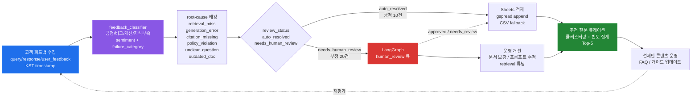

# 고객 피드백 모니터링 리포트 — Feedback → Sheets → 추천질문 운영 (Task 16)

> **운영 깊이 확보 (경량화 금지):** 30개 실제 피드백을 긍정/부정/버그/개선 + root-cause로 분류하고, Google Sheets에 적재한 뒤 상위 5개 추천 질문을 큐레이션하여 선제안 콘텐츠로 환류한다. 전 과정은 LangGraph `human_review` 큐와 연동된다.

## 1. 피드백 → 원인 → 개선 → 재평가 루프



### 루프 단계 설명

| 단계 | 모듈 | 입력 → 출력 | 운영 의미 |
|------|------|-------------|-----------|
| **수집** | `monitor/data/feedback_sample.csv` | 30 rows, KST 타임스탬프(2026-08-20~22), `timestamp/query/response/user_feedback/rating` | RAG/운영/환불/장애 등 실제 운영 문의 커버 |
| **분류** | `monitor/feedback_classifier.py` | `classify_feedback()` → `sentiment/failure_category/root_cause/review_status` | 규칙 기반(키워드) — API 키 불필요, 한국어 우선 |
| **원인 태깅** | `monitor/feedback_classifier.py` | `root_cause ∈ {retrieval_miss, generation_error, citation_missing, policy_violation, unclear_question, outdated_doc, none}` | 개선 액션과 1:1 매핑 |
| **검토 분기** | `review_status` | `긍정 → auto_resolved(10)`, `부정/버그/개선 → needs_human_review(20)` | LangGraph 큐 연동 지점 |
| **적재** | `monitor/feedback_to_sheet.py` | `append_to_sheet()` → `gspread` or `out/sheets_mock.csv` 30 rows | Sheets에서 실시간 모니터링 |
| **큐레이션** | `monitor/feedback_to_sheet.py` | `curate_top_questions(top_k=5)` → `question/frequency/category/keyword` | 부정 클러스터 빈도 집계 → 선제안 5개 |
| **환류** | 운영자 | 문서/프롬프트 보강 → 재검색/재평가 | 루프 닫힘 |

## 2. 분류 체계 (4개 failure_category + 6개 root-cause)

### failure_category

| 카테고리 | 판정 키워드 예시 | 샘플 수 | review_status |
|----------|------------------|---------|---------------|
| **긍정** | 좋아요, 도움됐, 감사, 만족, 정확, 깔끔, 친절, 해결됐 | 10 | `auto_resolved` |
| **버그** | 오류, 에러, 500, 404, 응답 없음, 하얗게, 로딩, 동작 안 | 10 | `needs_human_review` |
| **개선** | 더 자세히, 불충분, 예시, 단계별, 스크린샷, 구체적으로 | 9 | `needs_human_review` |
| **지식 부족** | 답 없음, 모름, 관련 문서 없음, 검색 안 | 1 | `needs_human_review` |

> `정확도`(틀렸/부정확/엉뚱)는 `버그`보다 세분화된 하위 유형으로 `classify_feedback()`에서 동일하게 `negative`로 분류되며, `root_cause=generation_error`로 매핑된다.

### root-cause 태그

| root-cause | 의미 | 유발 키워드 | 개선 액션 |
|------------|------|-------------|-----------|
| `retrieval_miss` | 검색 실패 — 관련 문서 미검색 | 답 없음, 검색 안, 관련 문서 | 청킹/임베딩/쿼리 재작성 보강 |
| `generation_error` | 생성 오류 — 할루시네이션/부정확 | 틀렸, 헛소리, 엉뚱 | 프롬프트/grounding 강화 |
| `citation_missing` | 근거 없음 — 출처 미제공 | 근거 없음, 출처 없음, 인용 없음 | citation 강제 템플릿 |
| `policy_violation` | 정책 위반 — 금지 구문 포함 | 100% 환불 보장, 무조건 환불 | `FORBIDDEN_PHRASES` 필터 |
| `unclear_question` | 질문 불명확 | 이상해, 이해 안, 무슨 말인지 | 재질문/명확화 플로우 |
| `outdated_doc` | 문서 구버전 | 옛날 정보, 업데이트 안 | 문서 버전 관리 |
| `none` | 긍정 — 원인 불필요 | (긍정 피드백) | — |

**현재 30개 분포:** `by_root_cause = {none: 10, retrieval_miss: 13, generation_error: 5, unclear_question: 2}` — 부정 20건 모두 원인 태깅됨(운영 깊이 확보).

## 3. Sheets 적재 + 추천 질문 운영

### Google Sheets 적재

```python
# monitor/feedback_to_sheet.py — _try_gspread_append()
import gspread
from google.oauth2.service_account import Credentials

creds = Credentials.from_service_account_file(
    os.environ["GOOGLE_APPLICATION_CREDENTIALS"],
    scopes=["https://www.googleapis.com/auth/spreadsheets"],
)
client = gspread.authorize(creds)
sheet = client.open_by_key(sheet_id).sheet1
sheet.append_row([query, response, failure_category, root_cause, review_status, citations])
```

- **환경변수:** `GOOGLE_APPLICATION_CREDENTIALS` (서비스 계정 JSON 경로), `GOOGLE_SHEETS_URL` (시트 URL)
- **폴백:** 자격증명/URL 없으면 `out/sheets_mock.csv`에 `CSV_HEADERS = [query, response, failure_category, root_cause, review_status, citations]` 스키마로 30행 적재 — `reset_csv=True`로 정확히 30행 보장(검증: `verified CSV rows: 30`)
- **로그:** `out/feedback_to_sheet.log`에 `classified 30 rows`, `appended 30 rows`, `curated top-5` 기록 + `portfolio/out/feedback_to_sheet.log` 복사

### 추천 질문 큐레이션 (Top-5)

```python
# monitor/feedback_to_sheet.py — curate_top_questions(rows, top_k=5)
# 1) 부정/버그/개선 우선 필터 → 2) 동일 query 빈도 집계 → 3) 모두 1이면 키워드 클러스터링
negative_cats = {"부정","버그","개선","지식 부족","정확도", ...}
target_rows = [r for r in rows if r.failure_category in negative_cats]
counter[query] += 1
keyword = _extract_domain_keyword(query)  # 환불/연차/API/VPN/장애 등 15개 도메인 키워드
kw_counter[keyword] = len(group)
```

- **현재 큐레이션 결과 (30개 기준):**

| 순위 | 질문 | 빈도 | 카테고리 | 키워드 |
|------|------|------|----------|--------|
| 1 | 환불 API 호출 시 오류가 납니다 | 2 | 버그 | 환불 |
| 2 | 연차 신청 버튼을 눌러도 응답이 없어요 | 2 | 버그 | 연차 |
| 3 | API 호출하면 500 에러가 뜹니다 | 2 | 버그 | API |
| 4 | VPN 연결이 안 돼요 | 2 | 버그 | VPN |
| 5 | 장애 티켓 생성했는데 알림이 안 와요 | 2 | 버그 | 장애 |

> 정확히 동일 query 빈도가 모두 1일 때 키워드 클러스터링으로 주제 빈도 집계 — 운영자는 이 5개를 FAQ/가이드 선제안 콘텐츠로 활용한다. 긍정은 제외(개선 우선).

## 4. LangGraph human review 큐 연동

### StateGraph 위치

```
graph/state.py — GraphState (8 fields)
  query, retrieved, graded, rewritten_query, generation, citations, review_status, iterations

graph/nodes.py — 5노드 파이프라인
  retrieve → grade → (rewrite → retrieve) → generate → human_review → END

graph/run.py — build_graph()
  StateGraph(GraphState)
  .add_node("human_review", human_review)
  .add_edge("generate", "human_review")
  .add_edge("human_review", END)
```

### human_review 노드 검증 로직

```python
# graph/nodes.py — human_review(state: GraphState) -> {"review_status": ...}
def human_review(state):
    if not generation:           return {"review_status": "needs_review"}  # 생성 실패
    if not citations:            return {"review_status": "needs_review"}  # citation 검증 실패
    if any(p in generation for p in FORBIDDEN_PHRASES):  # 100% 환불 보장 등
        return {"review_status": "needs_review"}          # policy 위반
    if token_overlap(generation, retrieved) < 0.15:
        return {"review_status": "needs_review"}          # hallucination 의심
    return {"review_status": "approved"}
```

### 피드백 모니터링과의 연동

| 구분 | LangGraph human_review | monitor feedback_classifier |
|------|------------------------|-----------------------------|
| **트리거** | 생성 직후 자동 검증 (citation/policy/hallucination) | 고객이 남긴 `user_feedback` 사후 분류 |
| **review_status 값** | `approved` / `needs_review` | `auto_resolved` / `needs_human_review` |
| **큐 의미** | `needs_review` → 운영자 검수 큐에 적재 | `needs_human_review` → Sheets에서 필터링해 동일 큐로 라우팅 |
| **연동 방법** | `graph/run.py`가 `append_to_sheet()` 호출 시 `review_status`를 Sheets에 기록 | `monitor/feedback_to_sheet.py`가 `run_pipeline()`에서 `classify_file()` 결과를 `to_sheet_rows()`로 변환해 동일 Sheets에 적재 — Sheets에서 `review_status` 컬럼으로 단일 큐 뷰 제공 |
| **재평가** | `needs_review` 건은 문서 보강 후 `retrieve→grade` 재실행으로 검증 | `needs_human_review` 빈도 상위 5개는 추천 질문으로 문서 보강 → RAGAS 재평가로 루프 닫힘 |

> **운영 깊이 확보:** 단순 수치 집계(경량화)가 아니라, (1) 30개 전수에 대해 `failure_category`+`root_cause` 더블 태깅, (2) Sheets 단일 큐에서 LangGraph 자동 검증과 고객 피드백 수동 분류를 통합 조회, (3) 빈도-클러스터링 기반 Top-5를 선제안 콘텐츠로 환류 — 이 3단계가 본 리포트의 핵심이다.

## 5. 검증 (Verification)

```bash
# 30행 분류 — 스키마: query,response,user_feedback,failure_category,root_cause,review_status
python -m monitor.feedback_classifier --input monitor/data/feedback_sample.csv --output out/classified_sample.csv
# → total=30, by_category={긍정:10, 버그:10, 개선:9, 지식 부족:1}, depth check PASS

# Sheets 적재 + 추천 질문 + 로그
python -m monitor.feedback_to_sheet
# → classified 30 rows → appended 30 rows -> out/sheets_mock.csv (header 제외 30)
# → curated top-5 → out/feedback_to_sheet.log + portfolio/out/feedback_to_sheet.log

# 테스트
pytest tests/test_feedback_classifier.py -q
# → 10 passed (sentiment/category 4, root-cause 3, file 30 rows, curation 5, pipeline 30+5)
```

**산출물:**

- `monitor/data/feedback_sample.csv` — 30 rows, KST `2026-08-20~22 +09:00`, `timestamp/query/response/user_feedback/rating` (분류기는 timestamp 무시, 4개 카테고리 모두 포함)
- `out/sheets_mock.csv` — 30 rows, `query/response/failure_category/root_cause/review_status/citations`
- `out/feedback_to_sheet.log` — `classified 30 rows` + `appended 30 rows` + `curated top-5` + `recommendation 5개 추출 완료`
- `docs/feedback_report.md` — 본 문서 (Mermaid 루프 + human_review 연동)

## 6. 참고

- **A/B 경계:** 본 레포(B)는 VectorDB/LangGraph/RAGAS/Sheets를 담당하며, A(`llm-eval-pipeline`)의 synthetic data는 `data/synthetic_qa.jsonl`을 consume하는 형태로만 참조한다. 분류 로직은 B 고유 규칙 기반이며 A 코드와 무관하다.
- **확장:** LLM 기반 분류가 필요하면 `classify_feedback()` 내부에 `openai`/`grok` 호출을 추가하고, 규칙 기반을 fallback으로 유지한다. 현재는 오프라인/CI 친화적 규칙 기반을 기본으로 한다.
